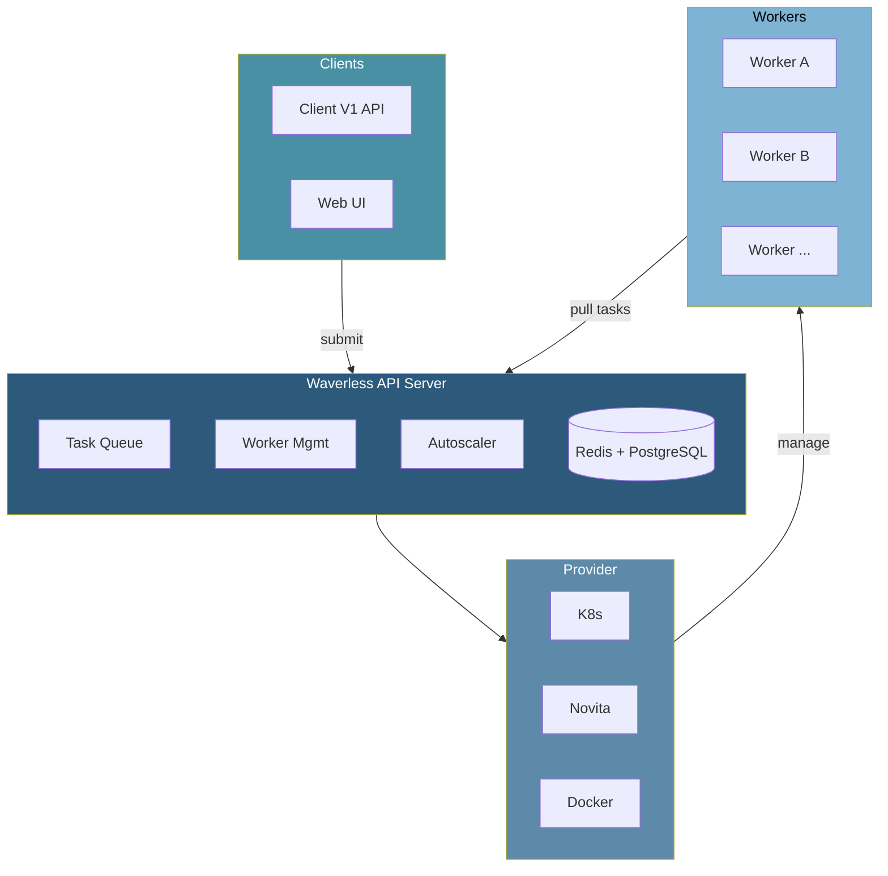

<div align="center">
  <a href="https://wavespeed.ai" target="_blank">
    
  </a>

  <h1>Waverless</h1>
  <p><strong>High-performance Serverless GPU Task Orchestration System</strong></p>
  <p>
    <a href="https://wavespeed.ai">馃寪 wavespeed.ai</a> 鈥?
    <a href="docs/ARCHITECTURE.md">馃搻 Architecture</a> 鈥?
    <a href="docs/USER_GUIDE.md">馃摉 User Guide</a> 鈥?
    <a href="docs/DEVELOPER_GUIDE.md">馃敡 Developer Guide</a>
  </p>
</div>

---

## Features

- 馃殌 **Pull-based Architecture** - Workers actively pull tasks for better load balancing
- 馃攲 **RunPod Compatible** - Zero-code migration from runpod-python SDK
- 鈽革笍 **Multi-Provider** - Kubernetes, Novita Serverless, Docker backends
- 馃搳 **Smart Autoscaling** - Queue-depth, priority, and resource-aware scaling
- 馃洝锔?**Graceful Shutdown** - Zero task loss during rolling updates

## Architecture



## Quick Start

```bash
# Local development
docker compose up -d postgres redis
cp config/config.example.yaml config/config.yaml
# Metadata DB env (optional if config.yaml already has postgres.*):
export METADATA_PROVIDER=postgres
export PG_HOST=127.0.0.1 PG_PORT=15433 PG_USER=wavespeed PG_PASSWORD=wavespeed PG_DATABASE=waverless
# Or a single connection string:
# export DATABASE_URL="host=127.0.0.1 port=15433 user=wavespeed password=wavespeed dbname=waverless sslmode=disable"
go run cmd/main.go

# Run the complete test suite with Go 1.25 and the PostgreSQL integration test
docker compose --profile test run --rm test

# Kubernetes deployment
./deploy.sh install
```

## API Example

```bash
# Submit task
curl -X POST http://localhost:8090/v1/my-endpoint/run \
  -H "Content-Type: application/json" \
  -d '{"input": {"prompt": "hello world"}}'

# Check status
curl http://localhost:8090/v1/status/{task_id}
```

## Documentation

| Document | Description |
|----------|-------------|
| [Architecture](docs/ARCHITECTURE.md) | System design, components, data flow, lifecycle |
| [User Guide](docs/USER_GUIDE.md) | Deployment, API reference, autoscaling, troubleshooting |
| [Developer Guide](docs/DEVELOPER_GUIDE.md) | Code structure, core design, provider integration |

## License

MIT License

---

**[WaveSpeed AI](https://wavespeed.ai/)** 鈥?AI image & video generation platform.
Try it in the browser: **[Image generator](https://wavespeed.ai/image-generator)** 路 **[Video generator](https://wavespeed.ai/video-generator)**
